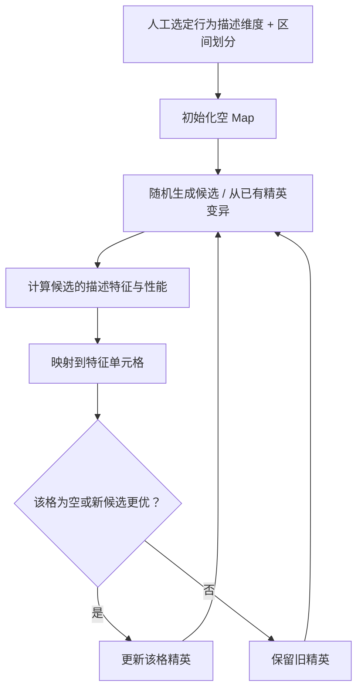

# P012｜MAP-Elites：按可解释行为特征保留多样化优胜者（搜索方法基线）

**来源身份**：Mouret & Clune 的 2015 年原始 MAP-Elites 预印本；这是进化式 Quality-Diversity/illumination 搜索方法，**不是 LLM、金融因子、Embedding 或 PCA 的论文**。[原文与核验范围](PAPER.md)。

**一句话**：不只找一个全局最佳解，而是在研究者指定的低维特征地图中，为不同区域分别保留当前表现最好的候选，让搜索结果同时显示覆盖范围和质量。

## 原文算法骨架（据 Figure 2 / §3 自绘）

## 具体机制（仅作者方法）

- **搜索空间 vs. 描述空间**：被搜索的解可以很复杂，而 Map 由人选定的、可解释的行为/形态描述维度构成；描述维度是 MAP-Elites 的关键设计输入（§2–3）。
- **地图更新规则**：候选先计算 behavior descriptor 和 performance；若相应格为空或候选表现优于原有成员，则更新该格保存的解（Figure 2）。
- **演化**：从已存精英中抽样，采用变异/交叉产生子代，重复测试；这种结构不会在每轮只保留全局最高分（§3）。
- **原文实验**：作者在机器人形态/运动及模块化神经网络等任务中测试；本次未核验完整实验重跑，也未做金融迁移验证。

**证据边界**：原始算法要求研究者选择有意义的 feature descriptors，**不提供自动发现金融子领域的 PCA 方法**；不能把 128 维文本向量直接当作 128 个独立可解释的 MAP-Elites 轴。该说明是算法适用范围，不是获批准的特化缺点或项目创新论断。

[arXiv 原文](https://arxiv.org/abs/1504.04909) · [原文可读页](https://arxiv.org/html/1504.04909)
