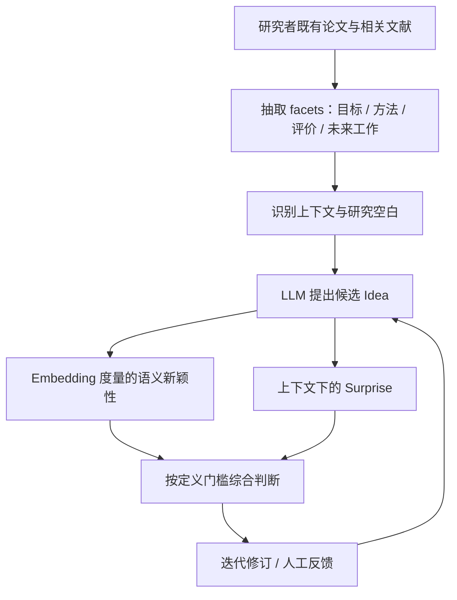

# P013｜SCI-IDEA：用结构化论文维度与 Embedding 支持科研 Idea 生成

**来源身份**：2026 年发表于 *Machine Learning* 的通用科研创意生成论文。任务不是金融因子研究；仅作为语义化 Idea 表示、研究空白和自动评价证据的跨领域参考。[原文与核验范围](PAPER.md)。

**一句话**：先从论文中提取研究目标、方法、评价、未来工作等结构化维度，再结合嵌入式新颖性与惊讶度指标生成、迭代修订科研想法。

## 原文架构简图（据 Figure 2 / §3 自绘）

## 具体机制与证据边界（仅作者方法和实验）

- **文献表示**：将每篇已有研究拆成目标、方法、评估和未来工作等 facets，再用于研究空白提取（§3）。
- **Idea 反馈**：使用 Embedding 表征的 novelty 与基于语境概率的 surprise 构成双信号；后续人工参与修订，不是直接证明科学突破（§3）。
- **作者实验**：涉及 100 名计算机科学研究者档案、多个 LLM 和 15 名博士级人工评价者。论文特别报告：LLM 自动评价与人工评分相关性非常低（论文摘要）。这些结果仅来自作者研究，不能作为金融新因子有效性的证据。
- **局限边界**：作者已明确写出新颖性度量主要相对于选取的上下文、自动评价与人工评价不一致。没有据此推断本项目已经具有科研创新能力。

**入库状态**：仅原文客观结构与作者公开结果；创新评价、独立不足、Delta 未获研究者批准。

[出版社开放原文](https://link.springer.com/article/10.1007/s10994-026-07036-8)
