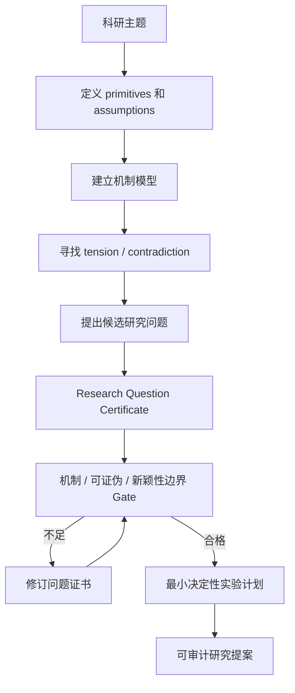

# P014｜FirstResearch：可审计的科研问题形成（方法论文）

**一句话**：将研究主题先拆成定义、假设、机制和矛盾，再产出包含可证伪假设、最小关键试验与失败更新规则的 Research Question Certificate（RQC），让“提出研究问题”成为可检查的明确产物。

- **来源**：[FirstResearch: Auditable Question Formation for LLM Scientific Discovery Agents](https://arxiv.org/html/2607.05682)，arXiv:2607.05682v1（2026-07-06）。[来源和核验范围](PAPER.md)
- **任务边界**：原论文研究 LLM 科研问题生成与审计，不是量化因子或实盘交易。

## 作者方法骨架（据 §3 与 Figure 1 自绘）

**独特位置（事实陈述，非研究者创新审批）**：RQC 明确写出什么观测会推翻假设、失败后应修改哪一条假设；与只生成 Idea 标题或只定义五维金融语义对象不同（原文 §3.2–3.3）。

**作者报告 / 证据边界**：十个 LLM-agent 研究主题，与三类受控 Prompt 级基线比较，使用 DeepSeek 盲评和 Gemini 对相同产物重评；作者强调**不是**复现这些基线的完整运行系统，也未进行金融数据验证。单次消融中证书主体贡献大，Meta/Reviewer 额外层并未证明提高当次评分；评价仍基于 LLM Judge，不等于真实科学发现。

仅入客观研究骨架；项目改进建议、创新/不足与 Delta 均未获研究者审批，不写为事实。
