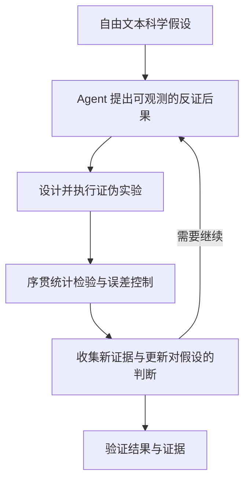

# P015｜POPPER：对开放式科研假设进行序贯证伪（方法论文）

**一句话**：把抽象的自然语言假设转化成可观测的后果，由 Agent 主动设计并执行反证性试验，使用序贯统计检验处理持续获取的证据，避免把不断试到“显著”的结果误判为发现。

- **来源**：[Automated Hypothesis Validation with Agentic Sequential Falsifications](https://proceedings.mlr.press/v267/huang25n.html)，ICML 2025，PMLR 267。
- **任务边界**：原文覆盖生物、经济与社会学等六类领域；不是针对股票交易或 Alpha 产生的金融论文。
- **[来源与核验范围](PAPER.md)**

## 作者方法骨架（依据 ICML/PMLR 官方摘要）

- 作者声称其 POPPER 框架包含 LLM Agent 设计和执行试验，以及严格的 Type-I error 序贯控制；并在六个领域进行实验（官方摘要）。
- 方法目的在于**验证自由形式假设**，不只是为生成的候选计算一次收益或相似度。
- **证据边界**：本条只直接核对了会议官方论文页摘要和题录，没有逐页核实论文的统计量、假设检验细节及全部实验；不可自行宣称其序贯检验保证可直接迁移至相关的金融时序数据。

本条仅作客观论文导航与初步机制骨架；未独立复现、未获任何研究者创新/局限/Delta 审批。
