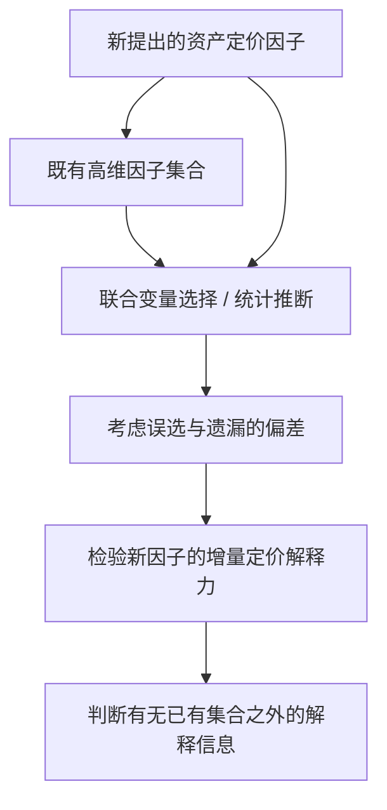

# P016｜Taming the Factor Zoo：检验新因子是否具有已有因子之外的增量解释力

**一句话**：面对大量已知资产定价因子，判断新增因子是否提供其他因子无法解释的定价信息；显式考虑高维变量选择可能产生的遗漏/误选偏差。

- **来源**：Feng, Giglio & Xiu，*Journal of Finance* 2020，[DOI:10.1111/jofi.12883](https://doi.org/10.1111/jofi.12883)，[NBER 工作论文](https://www.nber.org/papers/w25481)。
- **用途边界**：金融计量研究（新增定价因子检验），**不是** Alpha Agent 生成系统，也不等于交易策略净收益 uplift 评估。
- **[来源与核验范围](PAPER.md)**

## 研究问题与框架（依据作者正式摘要）

**作者主要结果（仅作者声称）**：许多新因子相对现有集合是冗余的，但个别因子仍具有统计显著的额外解释力。作者特别指出：简单变量选择方法忽略选择错误可导致有偏判断。

**证据边界**：上面是原始论文摘要支持的客观总结；未直接深入核对双重选择具体方程、所有数据和实证。其“增量解释力”属于资产定价统计概念，不能直接移植为公司策略实际新增收益的结论。本条未产生任何经批准的原创项目设计或 Delta。
