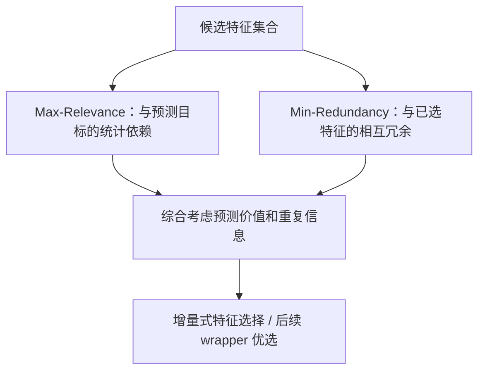

# P017｜mRMR：预测相关性与特征冗余分离的选择准则

**研究对象**：经典特征选择理论，不是 Alpha 发现 Agent 或量化回测论文。论文发表于 IEEE TPAMI 27(8), 2005。

## 原文机制骨架（依官方摘要，非代码复现）

- **实际机制**：以 Mutual Information 为主要统计依赖定义，提出 mRMR 作为 max-dependency 的一阶增量式近似准则；再将其与后续特征选择器结合，追求较紧凑、有效的特征集合。
- **原文证据**：作者报告在手写数字、心律失常、癌细胞系与淋巴瘤数据上测试；**没有金融因子或时间序列交易效果实证**。
- **重要界限**：不能将两个因子的相关系数直接等同于其对目标变量的增量信息；mRMR 原理论的互信息估计不等于我们已有 Gate2b 的 Spearman 相关。本文也没有提供对现行 Alpha 体系可直接替换的阈值。

**归档范围**：经出版方/数据库摘要核实的客观机制；未从完整原文逐节复核数学推导，未实验复现。项目改造建议、创新/不足评价及 Delta **均未审批**。

[论文 DOI](https://doi.org/10.1109/TPAMI.2005.159) · [PubMed 官方摘要](https://pubmed.ncbi.nlm.nih.gov/16119262/)
