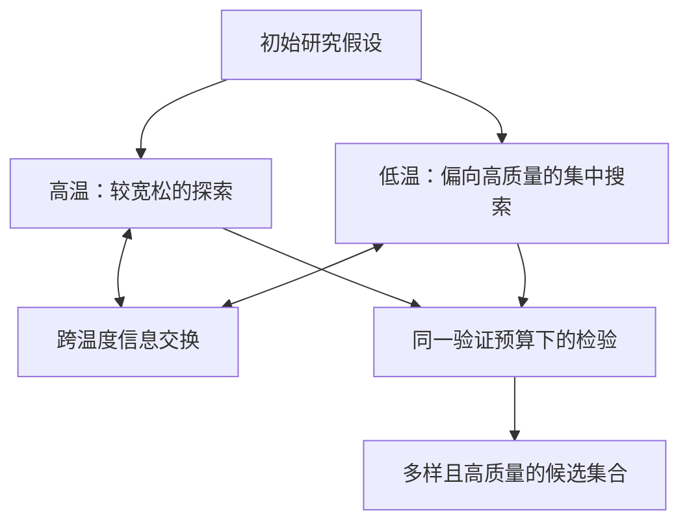

# P018｜EvoDiverse：多温度种群以缓解研究假设搜索的同质化

**研究对象**：通用科学假设搜索；ICML 2026 正式论文，非股票因子或金融 OOS 验证。原文提出 EvoDiverse，受并行回火启发，以固定验证预算兼顾候选质量与多样性。

## 原文机制骨架（据 ICML 官方摘要）

- **目标区别**：传统进化算法若只追逐最高评分，种群可能过早集中在狭窄区域；作者把假设探索理解为在固定预算下产生多个有质量且不同的候选，而不是只找唯一赢家。
- **机制**：多个温度层级并行搜索，并用跨温度交换在探索/利用之间交换信息。这里的“温度”是搜索选择压力设计，不是更换基础 LLM 参数。
- **作者实验**：据论文官方摘要，涵盖分子、方程和算法发现；报告相同验证预算下候选质量/多样性提升，**不是金融 Alpha 的独立新增证据**。
- **复现限制**：当前仅核对 ICML/PMLR 正式摘要与题录，详细接受率、参数和消融需继续核原文；在公司现有 16 Role 系统中不应直接套成生产级多种群调度。

仅归档客观研究骨架；项目改进建议及创新/特化不足/Delta **均未获研究者审批**。

[ICML / PMLR 正式入口](https://proceedings.mlr.press/v306/wang26gx.html) · [arXiv:2606.10587](https://arxiv.org/abs/2606.10587)
