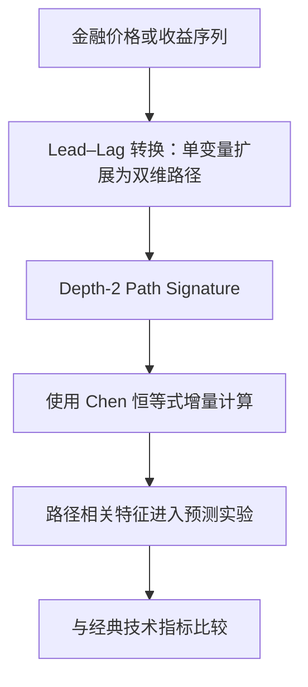

# P019｜Lead–Lag Signature：用低阶路径特征表示金融时间顺序

**研究对象**：金融时间序列预测中的路径特征；2026 年 *Journal of Forecasting* 论文，作者 Insu Choi。非 LLM / 自动因子搜索论文。

## 原文公开机制（依据期刊公开摘要）

- **方法**：作者将单变量时间序列转换为二维 Lead–Lag 路径，提取低阶 signature；以 Chen 恒等式增量更新，降低朴素高阶计算的复杂度。
- **作者报告的重要负面信息**：在覆盖股票、债券、外汇、商品和加密资产的实证中，对长债最有优势，**对股票的额外优势很少，简单动量更好**。因此不能因为它能表示更丰富的价格路径，就假定其适用于目前的美股价格面板。
- **数据边界**：纯价格路径在形式上与可用分钟 Close 兼容，但是否可用、是否已有同构实现或是否有独立预测价值都未在本项目验证；不能将该文作为公司 Alpha 效果证明。

归档仅基于期刊公开摘要，尚未逐页核对全文及复现实验；未获创新/不足/Delta 审批。

[期刊论文入口](https://onlinelibrary.wiley.com/doi/10.1002/for.70176)
