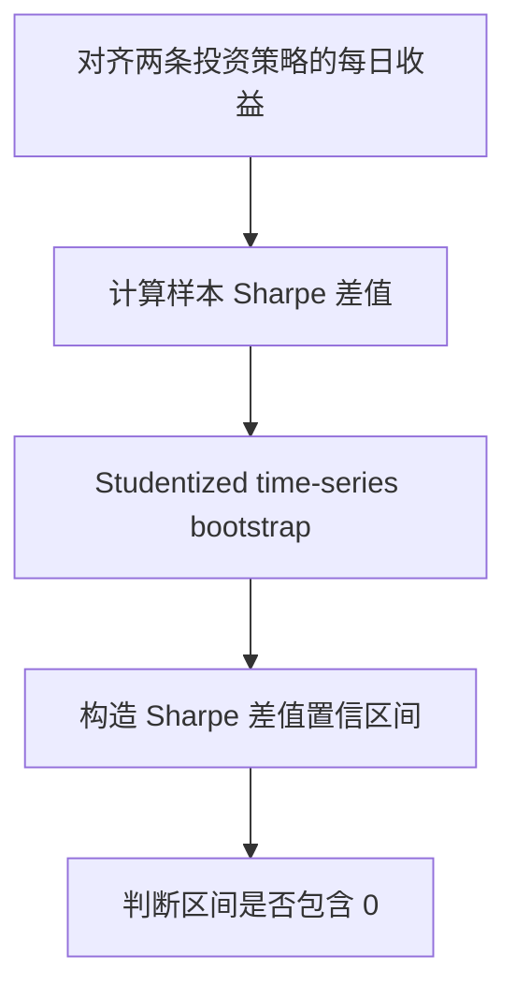

# P020｜Robust Performance Hypothesis Testing with the Sharpe Ratio

**论文研究问题**：当两条投资策略的历史 Sharpe 不同时，如何判断差异是否具有统计证据，尤其当收益序列存在厚尾或时间依赖时？

- **原文**：Oliver Ledoit、Michael Wolf，*Journal of Empirical Finance* 15(5):850–859 (2008)，[DOI:10.1016/j.jempfin.2008.03.002](https://doi.org/10.1016/j.jempfin.2008.03.002)。
- **客观方法**：作者指出基于正态独立假定的常见 Sharpe 差检验可能失效，提出 studentized time-series bootstrap 置信区间方法；置信区间若不包含 0，支持两策略 Sharpe 存在差异。
- **研究范围**：比较**既定**的两条投资策略，不是自动决定相关性阈值、不负责分类 Alpha/Factor/Loser，也不能消除在相同数据上反复生成和择优带来的全部选择偏差。
- **原文方法骨架**：

**证据边界**：本轮直接核对了出版方/学术摘要和作者公开原稿摘要；没有执行作者完整代码或逐条复核全文公式。全文统计前提、区块长度与金融因子池迁移需要单独核查。**不将其视为已获批准的 Gate2b 改造**。未审批任何项目创新/特化风险/Delta。

[核验记录](PAPER.md)
