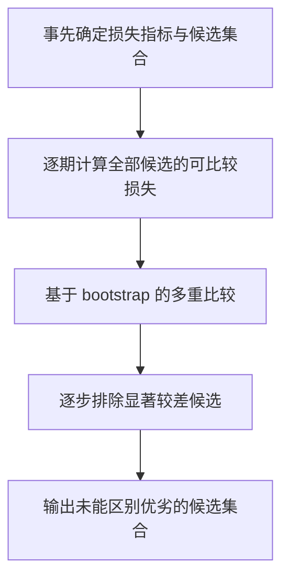

# P021｜The Model Confidence Set：不强行从多候选中选一个唯一赢家

**论文研究问题**：在一组竞争模型中，根据用户事先指定的评价损失和可用证据，怎样形成“可能包含真正最佳者”的候选集合，而不是因样本内微弱排名差就断言某个唯一获胜者？

- **原文**：Peter R. Hansen、Asger Lunde、James M. Nason，*Econometrica* 79(2):453–497 (2011)，[DOI:10.3982/ECTA5771](https://doi.org/10.3982/ECTA5771)。
- **客观机制**：给定候选模型和逐期可比较的损失序列，通过多重比较与 Bootstrap 构建 Model Confidence Set (MCS)；数据证据弱时可能保留多模型，证据强时缩小集合。
- **原文应用**：通胀预测及 Taylor Rule 模型比较，非金融 Alpha/Factor/Loser 三库实证。
- **方法骨架**：

**边界**：不能把“同属 MCS”解释为经济价值完全一样，也不能把 MCS 自动用于 Sharpe；标准接口基于逐期损失矩阵，若要直接比 Sharpe 应另选相应统计方法。论文不支持单凭 2017 训练数据多次反复搜索后宣称 OOS 改进。

[核验记录](PAPER.md) · [`arch.bootstrap.MCS` 实现文档](https://arch.readthedocs.io/en/stable/multiple-comparison/generated/arch.bootstrap.MCS.html)

**审批**：仅客观论文骨架，未审批公司 Gate2b 修改、独立创新/不足或 Delta。
