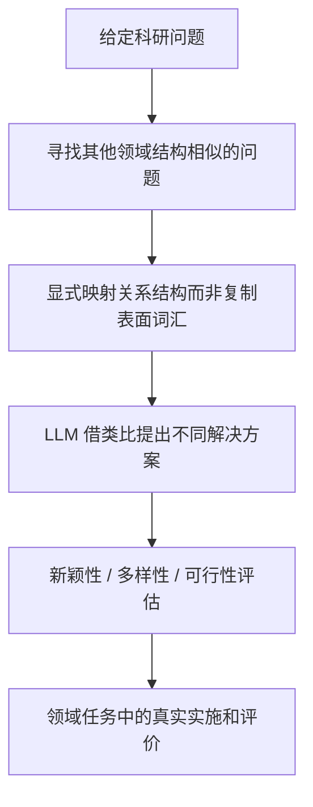

# P022｜跨领域关系类比引导科研方案生成

**原文**：[Unlocking LLM Creativity in Science through Analogical Reasoning](https://arxiv.org/html/2605.11258)（Andrew Shen、Shaul Druckmann、James Zou；arXiv:2605.11258，2026 预印本）。这是科研方案生成、尤其是生物医学案例研究，不是股票因子实验。

## 原文方法骨架（据原文 §3 和摘要）

- **搜索对象**：源领域问题与目标领域问题之间共享的*关系结构*，并将此关系映射用作生成不同方案的条件，针对 LLM 开放式生成的同质化。
- **作者报告**：在研究问题生成中，相较所比较的基线，生成多样性指标提高约 90%–173%；还报告四项生物医学任务的实施结果。这是作者实证，不是金融 Alpha 结果。
- **证据边界**：即使关系类比新颖，也不能直接证明金融因果、有效预测信息或交易收益。原文研究没有验证金融因子系统的收益提升。

只记录论文的来源与客观机制；**未批准本项目对应的改进想法、创新评定、独立不足或 Delta**。

[来源与阅读边界](PAPER.md)
