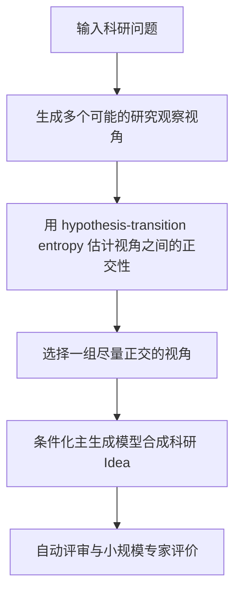

# P023｜PRISM：正交研究视角选择，而非盲目堆积视角数量

**原文**：[PRISM: Entropy-Guided Multi-View Exploration for Scientific Idea Generation](https://aclanthology.org/2026.emnlp-main.1180/)；Yu 等，EMNLP 2026，2026 年 10 月发表。研究科研 Idea 生成，不研究金融因子。

## 原文方法骨架（依据 ACL Anthology 官方摘要）

- **控制位置**：不主要改变评估器或模型权重；在最终生成前先构造多种观察视角，并从中选择尽量正交的子集。
- **作者实验**：报告覆盖 23 科学领域的 500 个研究问题，三种生成模型，以及自动评价和五名博士级人员的盲评；其新颖性/影响评价并非现实金融收益。
- **证据边界**：正交视角估计不同于最终因子数值独立性。本文不是“16 个金融 Agent 必须重组”的直接证据。

仅归档客观来源与方法；**本项目具体想法、创新或 Delta 尚未获审批**。

[来源与核验](PAPER.md)
