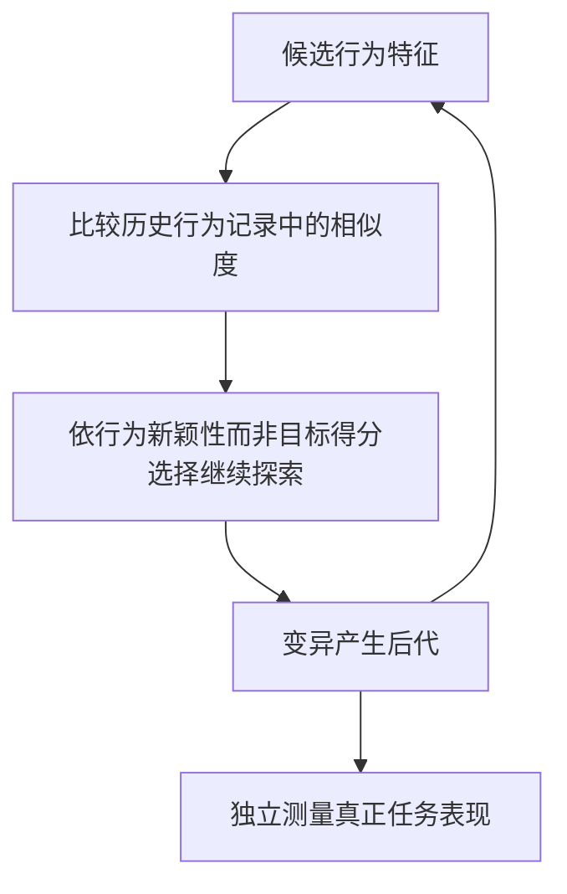

# P024｜Novelty Search：搜索行为上的新颖性，不始终追逐当前单项最佳得分

**原文**：Joel Lehman、Kenneth O. Stanley，*Evolutionary Computation* 19(2):189–223（2011），[DOI:10.1162/EVCO_a_00025](https://doi.org/10.1162/EVCO_a_00025)。研究进化搜索中的欺骗性目标，并不是金融 Alpha 搜索论文。

## 客观方法骨架（依据出版方摘要）

- **原始思想**：在目标函数容易导致搜索走进局部死胡同时，直接鼓励新的**行为模式**，而不只追逐当前 objective score。作者在迷宫和双足步行任务中作比较。
- **与 MAP-Elites 的关系**：P012 以预设 descriptor 网格在不同位置保存精英；本篇强调不以目标得分驱动搜索的行为新颖性机制。并非同一篇论文或完全相同的实现。
- **证据边界**：在金融因子搜索中，追求新颖性可能大量产生无预测价值的候选。因此不存在“越新颖越有 Alpha”的作者实证支持，也不要求改变现有金融合格门槛。

仅归档论文事实；不提出或批准公司实际策略规则。无经批准的创新/不足/Delta。

[来源与核验](PAPER.md)
