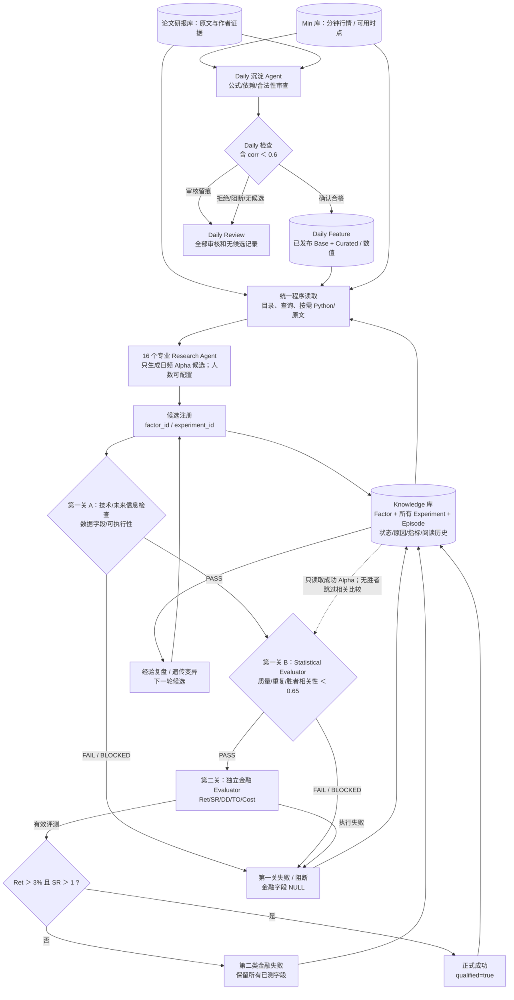

# Research Loop｜V1.0.1 当前正式流程图

> 更新：2026-10-29。设计已拍板，尚未实际部署验证。**以下流程优先于 10 月 28 日的旧图**；保留四库及 Full/Masked、后验去重、未来信息门禁、实验回流和遗传搜索，但不把 Score / 单独 Alpha 库作为必经步骤。

## 主流程

## 四库含义

**最新四库读写与研究日志实施契约**：[FOUR_LIBRARY_RUNTIME_CONTRACT.md](FOUR_LIBRARY_RUNTIME_CONTRACT.md)。图中的 M1 审核历史写入 Daily Review，**不**把审核失败误写入 Knowledge Experiment；文献结构化、全量自主检索和三模式随机探索由本契约补充。

- **Min**：不可随实验效果重写的真实分钟原始数据/字段/可用时点。
- **论文/研报**：人为收集的原始来源，作者陈述必须带 `external_reported` 标签。
- **Daily**：由独立 Daily Curator 自主构造与审核的日频中间特征，具有合法定义、依赖、时点、数据版本和物化 CSV；相关性 `<0.6` 是它自己的准入条件。Research Agent 只能读取已发布 Daily，不负责申请、构造或入库。
- **Knowledge**：因子定义 + 每次真实测试与全链失败/成功记录；其中 `qualified=true` 的实验可以直接查询为正式成功 Alpha。Alpha 与当前 Knowledge 中已成功胜者逐一比较最大绝对相关性，严格 `<0.65`；首个无胜者时只跳过这一比较。它不需要额外的物理或逻辑 Alpha 库。外部作者实验与内部 `internal_executed` 结果分离。

**职责隔离**：Research Agent 的日频 Alpha 输出与 Daily 库的中间特征不能混称。当前 Research 使用 [16份独立专业 Alpha Prompt](research_design/prompting/README.md)（草案未试跑）；Daily Curator 是独立 M1。两者可分别更换内部 Prompt，不影响统一技术、统计与金融评价。

## 避免生成阶段锚定

研究者可以选择 `full` 或按 `seed` 重现的 `masked` 信息暴露。只屏蔽部分已有 Alpha 结论/谱系，不遮蔽客观数据字段、数据时点、Evaluator 标准和工具安全。候选生成后恢复完整知识范围做去重与前置统计检查。查询由 Research Agent 自行调用统一接口，**不强制增加检索/材料分配 LLM**。

## 独立模块、按需工具

[模块与状态](PROCESS_AND_MODULES.md) · [两阶段门槛](GATES_AND_DECISIONS.md) · [CSV 字段契约](KNOWLEDGE_AND_CSV_CONTRACT.md)。每一次候选、阻断、财务/金融评价和遗传子代，都走相同的前置程序关卡；禁止 Agent 自行宣布其已通过或已入库。
