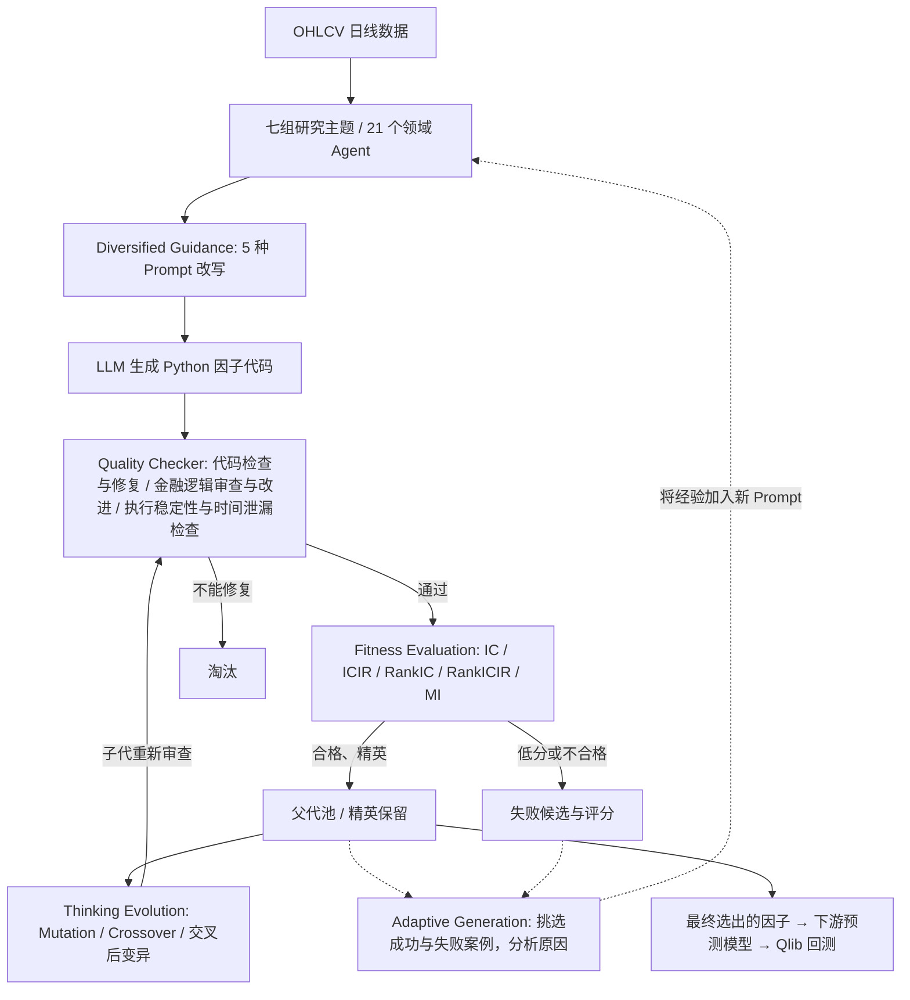

# P002 · CogAlpha：架构、作者贡献和待验证研究问题

> **用户明确要求归档的专题总结**（2026-10-21），不是恢复 `notes/` 逐篇流水账。  
> **研究阶段**：CogAlpha 核心机制已讨论；以下关于缺点及改进的内容为**本篇的初步研究问题**，不意味着项目整体进入跨论文阶段二/方案阶段三。  
> **正式来源**：Liu et al., *Cognitive Alpha Mining via LLM-Driven Code-Based Evolution*, ACL 2026，[ACL Anthology](https://aclanthology.org/2026.acl-long.538/)、[DOI](https://doi.org/10.18653/v1/2026.acl-long.538)、[arXiv HTML v4](https://arxiv.org/html/2511.18850)。

## 1. 最核心的一句话

**专业化 Agent 分方向提出因子 → LLM 编写 Python 因子代码 → 多 Agent 质量检查 → 预测指标筛选 → 变异/交叉产生下一代 → 成功与失败案例反哺生成 Prompt。**

系统改变的是**因子代码、候选种群及后续 Prompt**，不是重新训练 LLM 参数，更不能仅因反馈循环就称为严格的递归自我改进（RSI）。新因子进入 LightGBM/Ridge 等下游预测器，并借助 Qlib 做模拟回测；LLM 本身不直接负责下单。

## 2. 架构图（依据 Figure 1 和 §3.1–3.6 自绘）

此图是**逻辑骨架示意，不是原文 Figure 1 的复制**；原流程还包括多轮演化、精英继承及周期性新因子注入。**实线是候选生成/筛选，虚线是经验反馈**。参见 [§3 方法](https://arxiv.org/html/2511.18850#S3)。

## 3. 专业化多 Agent 是怎么实现的？

作者使用默认基座 **gpt-oss-120b**，用不同角色与任务 Prompt 让 21 个 Agent **各自独立**探索金融研究方向；**不是训练 21 个不同权重的专用模型，也不是 7 个必须串行通过的处理阶段**。

| 七组金融研究主题 | Agent 数 | 各自寻找什么 |
|---|---:|---|
| 市场结构与周期 | 2 | 趋势、周期、波动状态 |
| 极端风险与脆弱性 | 2 | 尾部风险、崩盘先兆 |
| 量价动态 | 4 | 流动性、买卖压力代理、量价关系、成交结构 |
| 价格与波动行为 | 5 | 动量、反转、区间波动、滞后效应、波动不对称 |
| 多尺度复杂性 | 2 | 回撤、多尺度/分形 |
| 稳定性与状态门控 | 2 | 信号稳定性、市场状态过滤 |
| 几何形态与融合 | 4 | K 线结构、组合与复合因子、羊群行为 |
| **合计** | **21** | 同样的 OHLCV，不同搜索先验 |

同一个领域 Agent 还获得 **light / moderate / creative / divergent / concrete** 五种不同提示引导，防止只反复生成同类公式。**专业 Agent 间并非以正式辩论为主要协作机制**；它们由共同候选池、质量检查、评分和进化循环连接起来。质量检查另设 Code Quality、Code Repair、Judge、Logic Improvement 四类角色。原文：[§3.1–3.3](https://arxiv.org/html/2511.18850#S3)。

## 4. 作者自己宣称的创新（按原文 Introduction）

1. **Cognitive Alpha Mining 概念**：强调更广的结构化搜索、金融含义与可解释性。
2. **CogAlpha 系统方法**：进化式 LLM 搜索，结合七层专业 Agent 与多 Agent 质量审查。
3. **实验证据**：在 3 个市场、5 组股票数据上报告更好的预测表现与泛化表现。

这些是**作者的贡献声明**，不是我们已经证明该领域首次出现这些算子/组件。原文：[§1 Main Contributions](https://arxiv.org/html/2511.18850#S1)。

### 更准确的技术亮点（我们的架构提炼）

| 模块 | 具体实现 | 核心作用 |
|---|---|---|
| **专业分工 + 提示多样化** | 21 个主题 Agent + 五种提示改写 | 扩大可探索的金融假设空间 |
| **代码级进化** | LLM 修改 Python 代码（Mutation）、融合两个因子（Crossover）及先交叉后变异 | 不仅搜索预先约束的表达式模板 |
| **多层质量把关** | 代码/金融逻辑审核修复、数值稳定性、时间泄漏单元测试 | 减少无法执行、不合逻辑或潜在违规使用未来数据的候选 |
| **外部评分 + 经验反馈** | 五指标筛选，随机抽取两个有效及两个失败候选及原因指导下一轮 Prompt | 让新一轮生成受历史实验结果影响，而不是完全独立采样 |

Mutation 与 Crossover 是**经典遗传操作**；LLM 辅助进化式编程也有前人工作（论文 Related Work 提到 FunSearch、AlphaEvolve 等）。这里更稳妥的说法是**针对因子挖掘任务的系统集成、专业组织和代码级搜索设计**；是否具备同领域首创性，要在以后跨论文查新后判断。

## 5. 实验真正能支持什么？

- 主实验：CSI300，主要预测未来 10 日收益；时间切分训练 2011–2019、验证 2020、测试 2021–2024；另有 CSI500、S&P500、HSI、HSCI。
- 论文表 1 报告 CogAlpha：**IC = 0.0591、AER = 16.39%、IR = 1.8999**。但 RandomForest 的 **RankICIR 0.4385** 高于 CogAlpha **0.4350**，不能说所有指标全面第一。
- 附录 B.7 的逐步消融，基础 Agent → +E 进化 → +A 适应反馈 → +G 多样化引导 → +H 层次 Agent，AER 依次是 **7.89%、8.08%、8.25%、12.45%、16.39%**。这是**逐步叠加**，不是每个模块都独立显著增益；加 E 后 IC 甚至下降。
- 回测采用 Qlib top-50/drop-5 **每日排名调整、最多换 5 只**，包含交易成本；**10 日预测标签不是 10 日调仓**。
- 上述都是**作者报告的回测/消融结果，不是独立复现或实盘证明**。来源：[§4](https://arxiv.org/html/2511.18850#S4)、[附录 B](https://arxiv.org/html/2511.18850#A2)。

## 6. 局限：严格区分作者承认与我们的疑问

**作者自己承认**（论文 Limitations）：只在 Qlib 中模拟，未真实实盘检验；LLM 生成的随机性影响复现；数据量增大带来额外执行时间。附录 B.6 明确报告的是**单次因子挖掘运行**，不能当成多随机种子均值。

**我们提出的待验证批判，不得写成已经证实的缺陷：**

1. **研究过拟合/重复筛选偏差？** 生成很多代、反复看评价指标，是否间接适应了验证样本？应使用完全隔离的最终时间外测试、滚动评估及多次独立运行检查。
2. **时间对齐是否严格？** 因子使用日频 OHLCV，却在开盘成交。如果用了 **t 日收盘/成交量**，便不能用于 **t 日开盘**；作者有未来数据单元测试，但这不自动覆盖所有数据可得时点与成交时点问题。需逐项审计而非直接断言存在泄漏。
3. **21 个专业 Agent 是否真正增加独立 Alpha？** 角色多不等于发现的因子不重复。需要检验代码语义/输出相关性、组合边际增益与同预算对照。
4. **反馈真的使搜索策略学会了什么？** 把成功失败示例放进 Prompt 是 in-context 引导，不等于跨任务经验学习或参数优化。可比较无反馈、随机示例、结构化失败反馈的有效性与成本。
5. **计算成本与稳定性是否合算？** 作者附录 B.5 报告单因子约 5–9 秒、一代约 1 小时，宜按**固定算力/调用数**比较净新增有效因子，而不是只比最优因子。

## 7. 可以继续想的三个方向（仅候选假设，**并非已成立原创成果**）

- **动态领域预算**：能否根据各 Agent 最近贡献的「独立有效因子」自适应调整领域搜索调用，而不是持续固定分配？需要在相同算力预算下对照验证。
- **结构化失败记忆**：将失败原因分成「不可执行、金融解释不合理、泄漏、同质化、时间外衰退」，用于指导后续生成；和原本随机采样两个失败因子的自然语言反馈比较，检验增量价值。
- **因果时间审计 + 搜索预算监管**：每个因子标注数据何时可得、何时能成交；同时隔离用于搜索调参的时间窗口与最终报告窗口，防止「生成越多看起来越好」的评价幻觉。

这些问题可以记作未来阶段二/三的**研究线索**，但现在没有系统查新或实验，不能说是我们的正式创新点。

## 结论

**CogAlpha = 分领域的 LLM 因子代码生成 + 代码级变异/交叉 + 多重质量检查和评分 + 历史成败反馈，形成自动搜索闭环；进化的是因子，不是 LLM 权重。** 作者的贡献主要是该金融任务上的具体机制组织与实验表现。后续的批判和优化方向必须与其他论文及独立实验对比才能成立。
