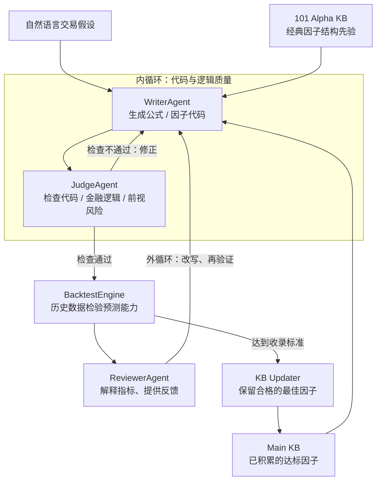

# P001｜Self-improving Alpha Mining：核心架构、作者贡献与研究追问

> **归档性质**：研究者要求记录的**单篇骨架总结**，非完整正文精读报告、非跨论文正式创新地图。2026-10-21。当前仍处于项目**阶段一（先理解论文）**；下文的研究问题与潜在改进只是供今后第二、三阶段验证的**候选假设**。
>
> **证据覆盖范围**：已核对期刊正式页面的 Highlights/Abstract、作者公开代码仓库 README，并查阅 2024 年 QuantAgent 原始摘要。**尚未逐页核对本论文 PDF 正文中的全部实验、消融和局限**；不可把未核细节当定论。

**论文**：Minh-Son Vu, The-Trung Pham, Hong-Viet Tran (2026), *Machine Learning with Applications*, Vol. 25, 100987。

- [期刊正式原文 / DOI](https://doi.org/10.1016/j.mlwa.2026.100987)
- [出版方页面（摘要、Highlights）](https://www.sciencedirect.com/science/article/pii/S2666827026001520)
- [SSRN 作者预印本页面（可尝试获取 PDF）](https://papers.ssrn.com/sol3/papers.cfm?abstract_id=6906675)
- [作者公开代码与实验说明](https://github.com/VMSSON345/Self-Improving-Alpha-Mining-for-Quantitative-Trading-via-Multi-Agent-Large-Language-Models-with-Know)
- [需要区分的先前工作：QuantAgent (2024)](https://arxiv.org/abs/2402.03755)

## 1. 一句话讲清楚

**用经典因子公式指导 LLM 生成新因子，以“代码审查内循环 + 金融回测外循环”迭代优化，同时把筛选出的有效因子保存到知识库，辅助未来生成。**

任务是**生成并验证 Alpha 因子**，而非让 LLM 直接执行交易。

## 2. 核心架构图（机制示意，不是作者图的直接复制）

**只记三句话**：

1. **101 Alpha KB = 先学前人的数学套路**，减少完全凭空生成。
2. **内循环 = 确保因子代码/逻辑站得住；外循环 = 用真实评价结果改进因子。**
3. **Main KB = 把符合条件的成功因子留下，为下一次生成提供参考。**

图依据作者官方仓库的组件职责说明概括；实际过程、阈值与循环条件需查论文方法/代码，不将这张简图当作逐条已验证的原论文流程图。

## 3. 作者明确主张的贡献，与“原始创新”边界

| 内容 | 我们应该怎样准确理解 | 证据级别 |
|---|---|---|
| **引入 WorldQuant 101 结构化检索先验** | **作者在摘要里称它是 key contribution**：生成不再完全无约束，利用经典公式结构/算子模式辅助探索 | **期刊摘要直接支持** |
| **嵌套内外循环 + Writer/Judge/Backtest/Reviewer** | 是该系统的重要工作架构，但不能说「双循环由本文首次发明」；2024 年 **QuantAgent** 已描述内外双循环与知识库更新 | 作者仓库 + QuantAgent 原始摘要 |
| **Main KB 长期积累 + 101 Alpha KB 的互补** | 一个提供已有因子结构，一个提供以前筛选出的有效因子；共同帮助后续 LLM 生成 | 作者仓库；相互增益的精确消融幅度待正文核查 |
| **越南股票市场上的实证实现** | 作者将流程实现在该股票市场，并报告样本外因子表现和搜索速度 | 期刊 Highlights/摘要与作者公开实验说明 |

**特别纠正**：「双循环 + 双知识库」是本论文**便于记忆的核心骨架**，**不是四个组件都由这篇论文首次提出**；判断真正的新颖性，需要与 QuantAgent 等先前工作逐一比较。

## 4. 结果只保留大方向和口径

作者代码仓库报告：越南市场经数据覆盖筛选后 **449** 只股票、**10** 个样本外交易想法中 **9** 个生成因子达到 IC ≥ 0.01、平均每个想法约 **1.5 分钟**；平均样本外 **IC = 0.048、Sharpe = 2.39**。期刊 Highlights 明确 Sharpe **未扣交易成本**，不能视为可直接实盘的净收益；这些均是作者报告，而非我们的独立复现。

**不能推出**：已证明跨市场稳定盈利、能够不断单调改进、具备模型参数级自训练或严格 RSI。

## 5. 我们的独立思考：不足和可能的改善方向（仅为待研究假设）

> 这里不是作者原文已证明的创新，也不是已经宣告「我们的创新点」。现在只登记有逻辑依据的研究问题，供以后大量论文积累后交叉验证、决定是否值得发展。

| 候选缺口 / 风险 | 可以探索的改进方向 | 后续怎样检验 |
|---|---|---|
| **知识库只突出成功案例**：可能反复走相似路线，忽略失败教训 | 考虑记录**失败原因 + 去重/相似性 + 多样性约束**，避免重复试错 | 比较有/无失败记忆及多样性管理的独立因子数量、相关性、样本外质量 |
| **经典 101 因子作为强先验**：可能提高有效率，也可能压缩新颖搜索空间 | 在“经典结构引导”和“开放式探索”之间做**动态探索比例** | 控制实验预算，检查有效率与真实新增、低相关因子的权衡 |
| **持续积累不等于适应市场变化**：历史上有效不保证换市场/换时期仍有效 | 把**市场状态、时间衰减、失效标签**用于知识检索与更新 | 前向滚动市场切分，比较静态 KB 与状态感知 KB 的退化速度 |
| **重复回测筛选可能产生选择偏差**，IC/毛 Sharpe 不等于净 Alpha | 加入多重检验、冻结最终测试、交易费用/换手/流动性约束 | 统计每次试验次数、严格 walk-forward OOS、扣费后真实改善是否仍成立 |
| **所谓 self-improving 主要是因子/知识库级别**，未证实模型权重或研究流程自我优化 | 区分「改当前公式」「改检索策略」「改研究工作流」等不同层级，探索更高层反馈是否必要 | 明确各层可修改对象，进行受控消融；不要把简单记忆等同 RSI |

这些只是**由机制推导出的合理风险/可检验方向**；并不意味着论文没实施任何控制。需阅读正文实验、现有代码、相关论文后再确认“真实缺口”和“相对前人的新颖性”。

## 6. 当前阶段结论

**最值得记住的特色不是“用了很多 Agent”，而是“用领域知识先验来约束生成，用回测反馈来迭代，用成功记忆影响后续探索”。**

本文件是应研究者明确要求而做的**单篇骨架归档与假设备忘**，不改变项目总流程：**先充分理解论文（阶段一）→ 后续跨论文比较创新/缺点（阶段二）→ 材料充足后有机提出原创方案（阶段三）**。下一步如果要把候选假设确认为创新点，必须先和更多原始研究核对。

